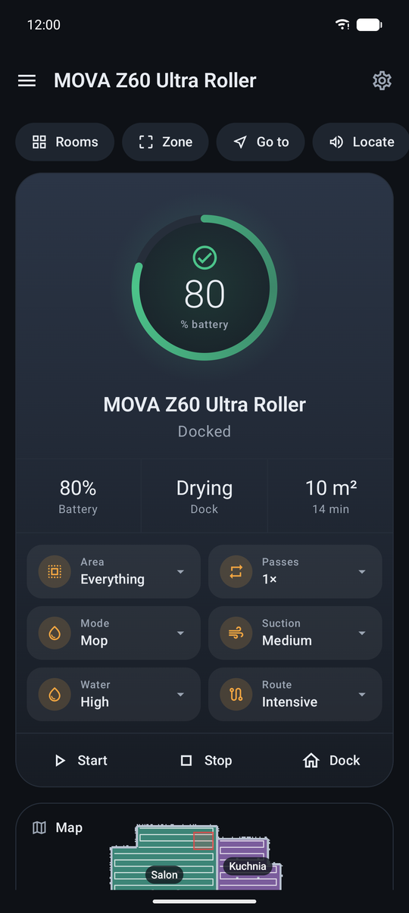
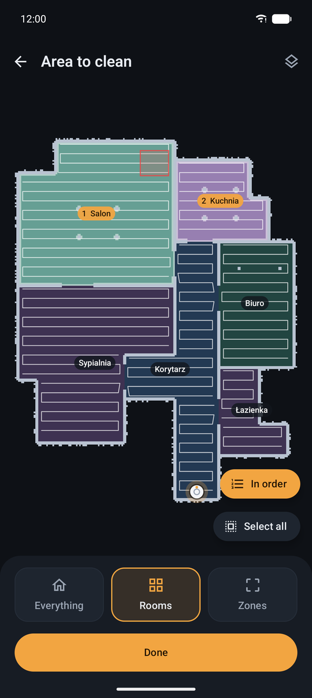
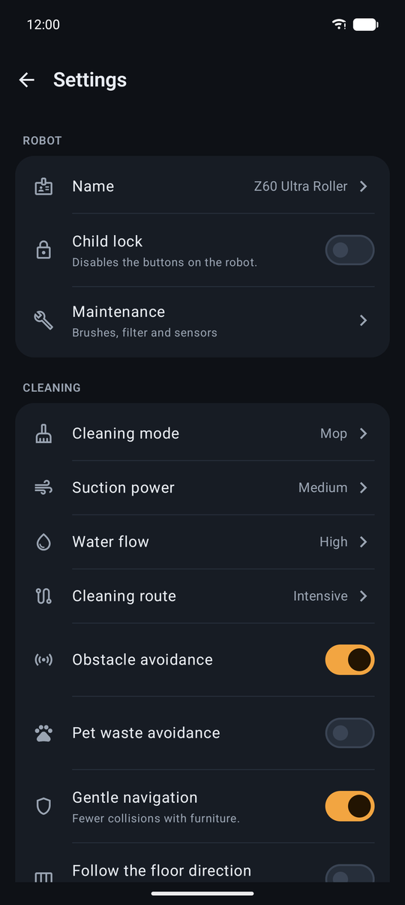
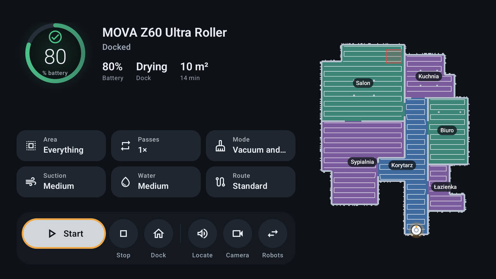
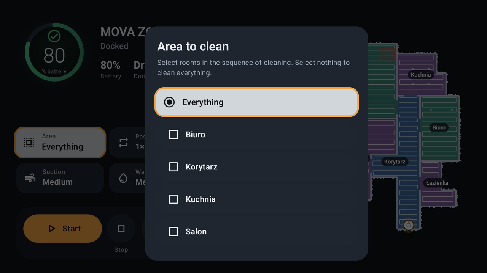

# Vacuum Companion for Valetudo

An Android app to control robot vacuums that run [Valetudo](https://valetudo.cloud).
It talks to the robot directly over your local network. There is no cloud and no account.

<p>
  
  
  
</p>

## Features

- Status, battery, cleaning mode, suction, water and route on one screen
- Live map: clean rooms in a set order, draw zones, go to a point
- Edit the map: rooms, virtual walls, no-go zones
- Settings for carpets, mopping, the dock, schedules, consumables and vendor quirks
- Camera view, if the robot has a camera
- Finds robots on the network automatically

The app reads the robot's capabilities and shows only the features that the robot supports.

## Android TV

The same APK runs on Android TV. It has a simpler interface that works with the D-pad.




## Install

Download the APK from [Releases](https://github.com/MDobak/VacuumCompanion/releases).

## Build

You need JDK 17+ and the Android SDK.

```sh
./gradlew assembleRelease
adb install -r app/build/outputs/apk/release/app-release.apk
```

The release build is signed with the debug key. Use your own key to distribute it.

Requires Android 10 (API 29) or newer.

## License

Licensed under the [Apache License 2.0](LICENSE).

The bundled [JSMpeg](https://github.com/phoboslab/jsmpeg) player is MIT-licensed, see `app/src/main/assets/jsmpeg-LICENSE.txt`.
